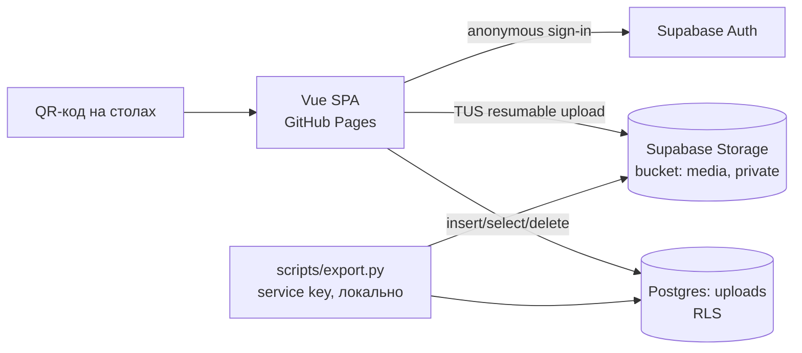

# wedding-moments — план, специфікація, архітектура, ADR

> Гостьовий сайт для весілля Яни та Віталія (4 вересня 2027): QR-код → відкрив → завантажив фото/відео → бачить свої завантаження.
> Принцип: **найпростіше, що працює на 25–27 гостях з телефонами у руках.**

**GitHub repo:** `wedding-moments`
**Опис (about):** `Guest photo & video sharing for a wedding: scan QR → upload → see your moments. Vue + Supabase, no custom backend.`

---

## 1. Цілі та межі

**Цілі**
- Гість без акаунта й реєстрації завантажує фото та відео з телефона.
- Гість бачить те, що завантажив сам (і може видалити).
- Ми з Яною після свята забираємо всі оригінали одним скриптом.
- Дизайн у стилі запрошення (див. розділ 5).
- Код можна згодом узагальнити і продати (але зараз НЕ будуємо під це).

**Не цілі (v1)**
- Мультитенантність, оплата, адмін-панель, коментарі, лайки.
- Серверне перекодування відео, розпізнавання облич.
- Спільна галерея для всіх гостей (це v1.1, див. ADR-006, вмикається одним прапорцем).

---

## 2. Специфікація

### Користувацькі історії
| # | Історія | Критерій прийняття |
|---|---------|--------------------|
| U1 | Гість сканує QR і потрапляє на сайт | Сторінка відкривається ≤ 3 с на 4G, без логіну |
| U2 | Гість додає кілька фото й відео одразу | Мультивибір; прогрес на кожен файл; помилка не ламає решту |
| U3 | Велике відео не губиться на слабкому інтернеті | Завантаження відновлюється після обриву (resumable) |
| U4 | Гість бачить свої завантаження | Сітка мініатюр, перегляд на весь екран |
| U5 | Гість видаляє своє помилкове | Видалення тільки власних файлів |
| U6 | Гість вказує ім'я (необов'язково) | Зберігається в локальному сховищі та в записі |
| U7 | Ми з Яною забираємо все | `scripts/export.py` завантажує оригінали в папки за іменем гостя |

### Функціональні вимоги
- FR1. Одна сторінка (SPA), укр. мова.
- FR2. `accept="image/*,video/*"`, мультивибір, без камери-тільки режиму.
- FR3. Клієнт генерує мініатюру (≈480 px, JPEG) для фото і кадр-постер для відео, завантажує поруч з оригіналом.
- FR4. Оригінали зберігаються **як є**, без стиснення і перекодування.
- FR5. Ліміти: розмір файлу та MIME-типи задає bucket (серверна перевірка, не лише клієнт).
- FR6. Перегляд — через signed URL з коротким TTL.

### Нефункціональні вимоги
- NFR1. Обсяг (моя оцінка, перевірити тестом): до 20–40 ГБ у гіршому випадку (≈80 фото × 4 МБ + кілька відео по 300 МБ на гостя).
- NFR2. Mobile-first: iOS Safari та Android Chrome — обов'язково; десктоп — «ок».
- NFR3. Без сторонніх CDN: шрифти self-hosted (`@fontsource`).
- NFR4. Секрети не в репо: тільки anon key у фронтенді; service key лише локально в `.env`.
- NFR5. Приватність: бакет приватний, посилання на сайт не індексується (`noindex`).

---

## 3. Архітектура



Власного бекенду немає. Вся «логіка доступу» — це RLS-політики.

### Модель даних

```sql
create table uploads (
  id          uuid primary key default gen_random_uuid(),
  owner       uuid not null default auth.uid(),
  guest_name  text,
  kind        text not null check (kind in ('photo','video')),
  path        text not null,          -- {owner}/{id}.{ext}
  thumb_path  text,                   -- {owner}/{id}_t.jpg
  mime        text not null,
  size_bytes  bigint not null,
  is_public   boolean not null default false,  -- v1.1: показати всім
  created_at  timestamptz not null default now()
);
alter table uploads enable row level security;

create policy "insert own" on uploads for insert
  with check (owner = auth.uid());
create policy "read own or public" on uploads for select
  using (owner = auth.uid() or is_public);
create policy "delete own" on uploads for delete
  using (owner = auth.uid());
```

**Storage** (bucket `media`, private, `file_size_limit` і `allowed_mime_types` задані на бакеті):
- insert: шлях починається з `auth.uid()` (`(storage.foldername(name))[1] = auth.uid()::text`)
- select/delete: те саме правило; для `is_public` — окрема select-політика через `exists` у `uploads`.

### Потік завантаження
1. Старт → `signInAnonymously()` (сесія в localStorage).
2. Для кожного файлу: згенерувати мініатюру → TUS-завантаження оригіналу → завантаження мініатюри → `insert` у `uploads`.
3. Черга: 2–3 файли паралельно; помилка одного файлу показується на ньому, повторити кнопкою.
4. Галерея: `select` своїх записів → `createSignedUrls` для мініатюр → за кліком signed URL оригіналу.

### Структура репо
```
wedding-moments/
├─ src/            # Vue 3 + Vite + TS, один view
├─ supabase/       # migrations/*.sql (схема, RLS, bucket)
├─ scripts/        # export.py (service key з .env)
├─ docs/           # цей план, ADR
└─ .github/workflows/deploy.yml  # build → GitHub Pages
```

---

## 4. ADR (скорочено)

**ADR-001. Без власного бекенду — Supabase (Auth + Storage + Postgres/RLS).**
Контекст: 27 користувачів, 1 день пікового навантаження, мінімум підтримки. Рішення: фронтенд ходить у Supabase напряму. Альтернатива: FastAPI + presigned URL (S3/R2) — більше коду й деплою без виграшу на цьому масштабі. Наслідок: безпека цілком у RLS → мусимо її протестувати (є в плані).

**ADR-002. Анонімна автентифікація + «секретне» посилання у QR.**
Рішення: `signInAnonymously()`, ідентифікація гостя = анонімний user id. Не потрібні паролі/OTP. Наслідок: якщо гість змінить браузер або очистить дані, він втратить доступ до *свого перегляду* (файли лишаються, ми їх бачимо в експорті). Ризик: якщо посилання витече, хтось може залити сміття. Мітигація: ліміти бакета; після свята вимкнути anonymous sign-ins у налаштуваннях Supabase.

**ADR-003. Пряме завантаження в Storage через TUS (resumable), без проксі.**
Причина: відео на слабкому wifi локації. Бібліотека `tus-js-client`. Для малих файлів — той самий шлях, щоб не мати двох кодових гілок.

**ADR-004. Мініатюри генерує клієнт; оригінали не чіпаємо.**
Причина: не потрібен серверний воркер/ffmpeg. Фото — canvas, відео — кадр через `<video>` + canvas. Наслідок: на поганому телефоні мініатюра може не створитись → показуємо плейсхолдер, оригінал усе одно збережений. HEIC: Safari декодує його в canvas; перевірити на реальному iPhone.

**ADR-005. Vue 3 + Vite + Tailwind, статика на GitHub Pages.**
Причина: твій стек і вже відомий деплой (як на PVS). Один екран, роутер не потрібен — немає проблеми зі SPA-fallback на Pages. Опційно: власний піддомен.

**ADR-006. Спільна галерея відкладена; закладено прапорець `is_public`.**
v1: гість бачить лише своє. v1.1: після свята вмикаємо `is_public=true` (SQL або скрипт) і додаємо вкладку «Усі моменти». Нульова зміна схеми.

**ADR-007. Single-tenant зараз; продаж — окремий рефакторинг.**
Імена, дата, тексти, кольори беремо з одного `src/config.ts`. Мультитенантність (`events`, `event_id` у RLS) — тільки якщо з'явиться реальний покупець. Не будуємо наперед.

**ADR-008. Зберігання: Supabase Storage на платному плані на час події, потім експорт і зниження плану.**
Причина: безкоштовний ліміт не покриє 20–40 ГБ і великі відео. Альтернатива — Cloudflare R2 (дешевий egress), але потребує окремого підпису URL/воркера → відхилено заради простоти. **Перевірити актуальні ліміти розміру файлу та квоти Supabase перед стартом.**

---

## 5. Дизайн (за запрошенням)

- **Настрій:** теплий крем, акварельні гілки оливи, тонка рамка по периметру, багато повітря.
- **Палітра (стартові значення, підігнати «піпеткою» з запрошення):**
  - фон `#F3EBDD`, картки/світліше `#FAF6EE`
  - текст `#5A4636`, тонкі лінії `#C9B8A3`
  - акцент (олива) `#7B7F5C`
- **Типографіка:** заголовок — сучасна serif з великим трекінгом (Cormorant Garamond), «та» — курсивний script-акцент (Pinyon Script або схожий), дрібні підписи — caps з широким letter-spacing. Усе self-hosted.
- **Композиція головного екрана:** гілки по кутах (SVG/PNG з запрошення, обрізані й почищені) → «ЗАПРОШУЄМО…» → **ЯНА *та* ВІТАЛІЙ** → `4 ВЕРЕСНЯ 2027` → велика кнопка «Додати фото та відео» → нижче «Ваші моменти».
- **Тон тексту:** тепло й коротко: «Поділіться тим, що побачили сьогодні».
- Кнопки: заповнені `#5A4636` на кремі або контурні з тонкою лінією; без яскравих кольорів і тіней.

---

## 6. План робіт і тести

| Етап | Результат |
|------|-----------|
| M0 | Репо, Supabase-проєкт, міграції (схема, RLS, bucket), deploy-пайплайн на Pages |
| M1 | Анонімний вхід, завантаження фото/відео (TUS), прогрес, повтор |
| M2 | Мініатюри, галерея «Ваші моменти», перегляд, видалення |
| M3 | Дизайн за розділом 5, `noindex`, копірайт |
| M4 | QR-код (макет для друку), тестовий прогін |
| M5 | `export.py`, інструкція «після весілля» (вимкнути anon sign-in, експорт, знизити план) |

**Тести (мінімум)**
1. **RLS:** користувач A не бачить і не видаляє файли користувача B; без сесії — нічого (скрипт на 2 анонімні сесії).
2. **Пристрої:** iPhone Safari, Android Chrome, одне старе пристрій.
3. **Мережа:** обрив wifi посеред відео 300+ МБ → має продовжитись.
4. **Навантаження:** 8–10 людей одночасно завантажують по 20 фото + 1 відео.
5. **Експорт:** кількість файлів у папках = кількість записів у БД.
6. **HEIC / портретні відео:** мініатюри та орієнтація коректні.

## 7. Відкриті питання
- Фактичні ліміти й ціна Supabase на момент події (ADR-008).
- Чи робити пароль-фразу на вході (зараз ні — достатньо секретного URL).
- Хто з гостей без смартфона — залишити для них паперову картку з QR?
- Домен: GitHub Pages `*.github.io` чи власний.
- Чи зберігати сайт живим після свята (читання тільки для нас), і як довго.
